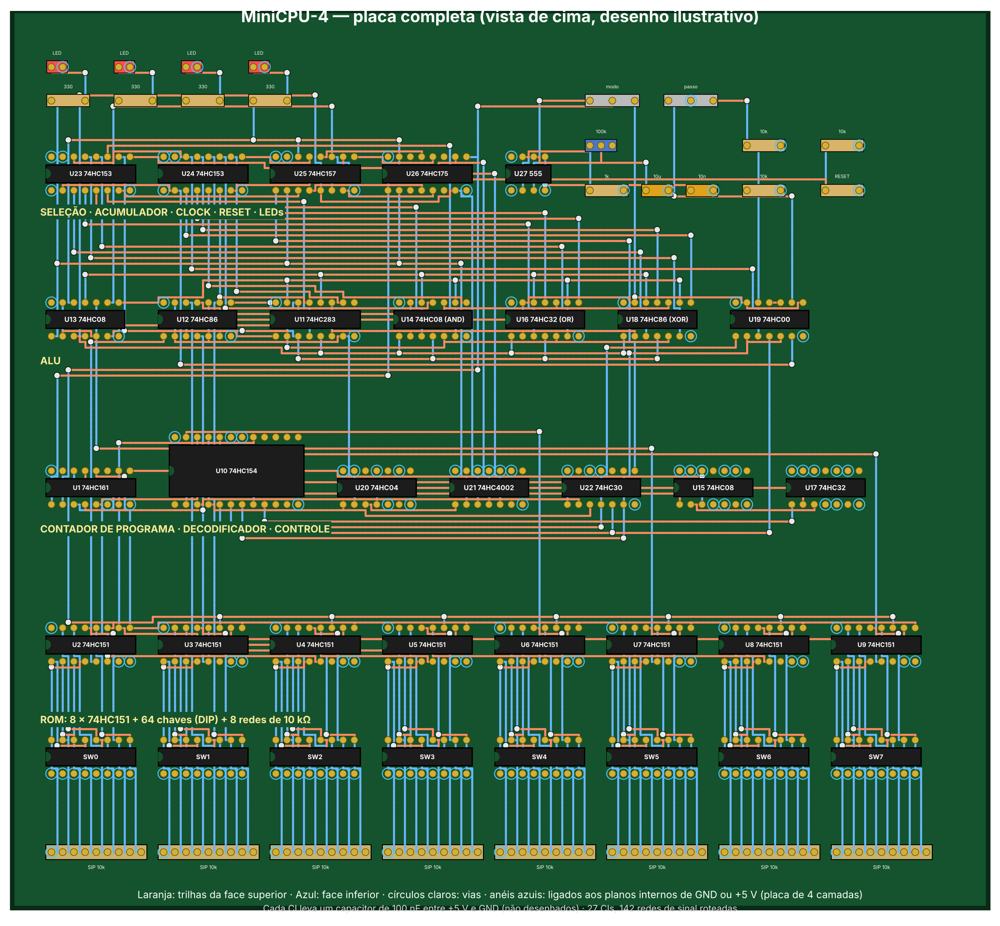
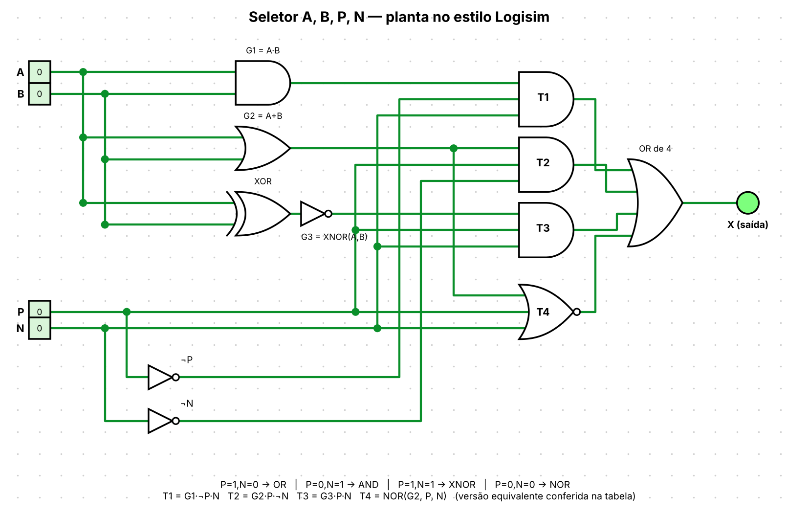

# Computador-1.0

Um circuito **seletor de função** (entradas A, B, P, N) e um **computador de 4 bits** (MiniCPU-4) construído a partir dele, com circuitos para o Logisim, simuladores em Python e no navegador, desenhos e documentação.

> Projeto educacional. Os circuitos foram verificados por **simulação**. Nenhuma das placas ou montagens descritas aqui foi construída fisicamente.

## O seletor

Duas chaves, **P** e **N**, escolhem qual porta lógica age sobre as entradas **A** e **B**:

| P | N | `seletor` | `seletor_com_NOT` |
|---|---|-----------|-------------------|
| 1 | 0 | A OR B   | A NOR B  |
| 0 | 1 | A AND B  | A NAND B |
| 1 | 1 | A XNOR B | A XOR B  |
| 0 | 0 | A NOR B  | A OR B   |

Juntos, os dois circuitos cobrem as seis portas de duas entradas (AND, OR, XOR, NAND, NOR, XNOR). O NOT do segundo circuito é a própria porta NOT.

## Como abrir no Logisim

1. Abra `circuitos/seletor.circ` no [Logisim](http://www.cburch.com/logisim/) (versão 2.7.1) ou em outra versão compatível.
2. Os dois circuitos, `seletor` e `seletor_com_NOT`, estão no painel da esquerda.
3. Mude os pinos A, B, P e N com a ferramenta de dedo e veja a saída X.

O arquivo usa só portas de 2 entradas e túneis, e não depende do modo do XOR de várias entradas. O arquivo original, que depende desse modo, está em `circuitos/original/`. Para regenerar o arquivo novo: `python3 circuitos/gerar_seletor_circ.py`.

## O computador MiniCPU-4

Computador de 4 bits, de ciclo único, em que **cada porta é uma célula do seletor** (355 células ao todo). Programa de até 8 instruções, acumulador de 4 bits e 4 LEDs de saída.

| Instrução | O que faz |
|-----------|-----------|
| `NOP` | nada |
| `LDI n` | ACC ← n |
| `ADD n` / `SUB n` | ACC ← ACC ± n |
| `AND n` / `OR n` / `XOR n` | operação bit a bit com n |
| `JMP n` | vai para a linha n (0 a 7) |
| `JZ n` | vai para a linha n se ACC = 0 |
| `HLT` | para |

Exemplo, contagem regressiva de 5 até 0: `LDI 5`, `SUB 1`, `JZ 4`, `JMP 1`, `HLT`.

**Limites:** não tem memória de dados nem porta de entrada, os números vão só de 0 a 15 e o programa tem no máximo 8 linhas.

### Simuladores

- **Navegador:** `docs/index.html` (com o GitHub Pages ligado, abre em `https://t2vares01.github.io/Computador-1.0/`).
- **Terminal:** `python3 simulador/minicpu4_simulador.py` (comandos: `p`, `ex`, `s`, `r`, `reset`, `ajuda`).
- **Lista de células:** `dados/MiniCPU4_netlist_celulas.csv`, gerada por `simulador/gerar_netlist.py`.

## Imagens

| | |
|---|---|
|  |  |
| Placa do MiniCPU-4 com 27 CIs 74HC (desenho ilustrativo) | Planta do seletor no estilo Logisim |

Outras imagens: `imagens/`.

## Documentação (PDF)

- `docs/pdf/MiniCPU4_computador_portas_logicas.pdf`: projeto, lista de compras e ligações pino a pino.
- `docs/pdf/MiniCPU4B_seletor_com_computador.pdf`: versão com tabela de consulta (LUT).
- `docs/pdf/MiniCPU4_todas_portas_trocadas_por_celulas.pdf`: o computador com todas as portas trocadas por células.
- `docs/pdf/planta_logisim_computador_completo.pdf`: as 355 células em 9 páginas.
- `docs/pdf/lista_de_compras_circuito.pdf` e `docs/pdf/seletor_planta_e_placa.pdf`: seletor em chips reais, placa e planta.

A versão com 355 células precisaria de cerca de 1.200 CIs 74HC, então ela é para simulação (Logisim ou Python). A placa desenhada é a do computador em chips 74HC.

## Testes

```
python -m unittest discover -s tests -v
```

Conferem as 16 linhas da tabela-verdade (a mesma do Logisim) na função da célula e nos dois circuitos do `.circ`, e rodam a contagem regressiva no computador. Rodam sozinhos a cada commit (GitHub Actions).

## Estrutura

```
circuitos/   seletor.circ (novo), original/ (arquivo antigo), gerar_seletor_circ.py
simulador/   minicpu4_simulador.py, gerar_netlist.py
dados/       lista das 355 células (CSV)
docs/        index.html (simulador web) e pdf/
imagens/     desenhos e diagramas
tests/       testes automáticos
```

## Licença

 Veja `LICENSE`.
